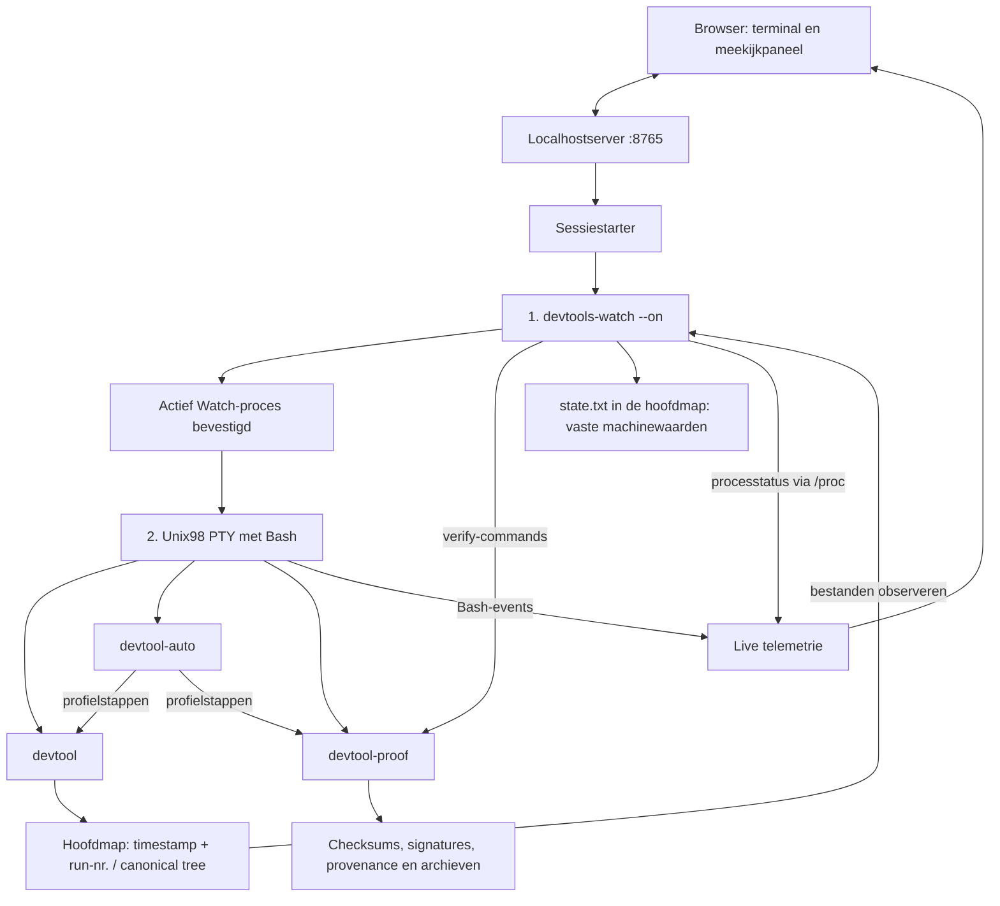

# Devtools

Vier zelfstandige Rust CLI’s voor bestandsstructuren, automatisering, bewijsberekening en een deterministische achtergrondmonitor. De localhostdemo combineert ze met een echte Bash-terminal en een live meekijkpaneel.

Iedere executable heeft een eigen Cargo-project, `main.rs`, `lib.rs`, configuratie en tests. De programma’s werken samen via CLI-opdrachten en bestanden. De meegeleverde binaries zijn **Android/Termux ARM64 ELF-executables**. Voor Linux bouw je de programma’s op het bijbehorende platform; ELF alleen maakt een Android-binary niet uitwisselbaar met Linux.

## De vier executables

| Executable | Versie | Verantwoordelijkheid |
| --- | --- | --- |
| [`devtool`](devtool/README.md) | 0.5.0 | Hoofdmappen met timestamp en runnummer, ingebedde canonical tree, bestanden, 7z/tar.gz en instellingen |
| [`devtool-auto`](devtool-auto/README.md) | 0.2.0 | Profielen, commandstappen, timers, filesystemwatchers en eigen automatiseringsregels |
| [`devtool-proof`](devtool-proof/README.md) | 0.2.0 | SHA-256/SHA-512, checksummanifesten, Ed25519, provenance en ZIP/7z met AES-256 |
| [`devtools-watch`](devtools-watch/README.md) | 0.1.0 | Achtergrondcontrole en het invullen van de vaste machinechecklist `state.txt` |

## Flowchart



De sessiestarter maakt Watch actief voordat Bash aan de terminal beschikbaar komt. Watch draait als los achtergrondproces, zonder controlling terminal. Bash voert de andere drie CLI’s op verzoek uit. `devtool-auto` kan ze als profielstappen aanroepen. Watch gebruikt de verificatiecommands van `devtool-proof` en schrijft de resultaten in `state.txt`.

Die onderliggende rol van Watch zit in de startvolgorde en levenscyclus. Er wordt geen bijzondere CPU-prioriteit ingesteld. Ctrl C in een foreground-command stopt Watch niet. Bash afsluiten of de localhostserver stoppen beëindigt de Watch van die sessie. Browserreload behoudt dezelfde sessie.

## Snel starten met de meegeleverde binaries

Voer dit uit vanuit de repository op Android/Termux ARM64:

```sh
export PATH="$PWD/devtool/dist:$PATH"
devtool --version
devtool-auto --version
devtool-proof --version
python devtool/demo/server.py --port 8765
```

Open daarna **http://127.0.0.1:8765**. Python en Bash zijn nodig voor de demo. De browserassets, inclusief xterm, staan al in de repository; een npm-installatie is niet nodig om de demo te starten. De canonical runner gebruikt `sh`, `mkdir` en `cp`.

Elke demosessie krijgt een eigen werkmap, HOME, XDG-configuratie en state onder `devtool/demo/workspaces/<sessie>/`. De terminal voert de echte executables uit en bewerkt echte bestanden in die testomgeving. De fake Linux-boom van het automatiseringslab bestaat uit gewone testmappen.

### Het live meekijkpaneel

De rechterkant toont:

- Het actieve Bash-command en de verstreken tijd.
- De vier executables met hun actuele status en PID wanneer gemeten.
- Een commandtijdlijn met gebruikte CLI-namen, duur en Bash-exitcode.
- De zichtbare Bash- en Watch-processen en hun subprocessen, met voorgrond/achtergrond en werkgeheugen.

`Telemetrie` en `Bestanden` wisselen tussen het meekijkpaneel en de bestandsboom met voorbeelden. `Paneel` klapt de zijbalk in of uit. Onder 761 CSS-pixels staat het paneel onder de terminal.

Bash-events registreren interactieve commandregels; menu-antwoorden blijven invoer van het actieve programma. De processtatus wordt elke 150 ms bemonsterd en de frontend haalt elke 350 ms nieuwe telemetrie op. Een kort proces kan tussen metingen vallen; zijn interactieve Bash-command blijft in de tijdlijn staan. Het API-overzicht bewaart de laatste 100 commandregels en de frontend toont de nieuwste 30. De exitcode is die van de gehele commandregel volgens de gewone Bash-regels.

## Zelf bouwen

### Automatische Linux- en macOS-builds

[Build all Devtools platforms](.github/workflows/build-cli.yml) bouwt en test de vier CLI’s voor Linux x86_64, Linux ARM64, macOS Intel en macOS Apple Silicon. Na een geslaagde run op main worden de complete bundels en afzonderlijke projectpakketten onder [`all-dist/`](all-dist/README.md) opgeslagen, met broncommit, Rust-target, executableformaat en SHA-256. Iedere run biedt ook een downloadbaar artifact per platform. Via Actions → Build all Devtools platforms → Run workflow start je handmatig een nieuwe build.

De workflow gebruikt native runners voor elk target, zodat de executables en de meegeleverde demo ook daadwerkelijk worden uitgevoerd. macOS gebruikt Mach-O, Linux gebruikt ELF. Watch gebruikt op macOS libproc voor procesidentiteit; de telemetrie gebruikt daar ps. Op Linux/Android blijft de procesbron `/proc`. De standaard macOS-Bash wordt ondersteund; bij Bash zonder `EPOCHREALTIME` hebben eventtijdstempels een resolutie van één seconde.

### Lokaal bouwen

De vier projecten blijven afzonderlijk bouwbaar. Gebruik Rust/Cargo en een toolchain die de vastgelegde dependencies in de `Cargo.lock`-bestanden ondersteunt.

```sh
cargo build --release --locked --manifest-path devtool/Cargo.toml
cargo build --release --locked --manifest-path devtool-auto/Cargo.toml
cargo build --release --locked --manifest-path devtool-proof/Cargo.toml
cargo build --release --locked --manifest-path devtools-watch/Cargo.toml
```

Plaats de resultaten in de distributiemappen. De demo gebruikt de vier executables uit `devtool/dist/`:

```sh
cp devtool/target/release/devtool devtool/dist/devtool
cp devtool-auto/target/release/devtool-auto devtool-auto/dist/devtool-auto
cp devtool-proof/target/release/devtool-proof devtool-proof/dist/devtool-proof
cp devtools-watch/target/release/devtools-watch devtools-watch/dist/devtools-watch
cp devtool-auto/dist/devtool-auto devtool/dist/devtool-auto
cp devtool-proof/dist/devtool-proof devtool/dist/devtool-proof
cp devtools-watch/dist/devtools-watch devtool/dist/devtools-watch
```

De meegeleverde `SHA256SUMS` beschrijven de gepubliceerde distributiebestanden. Een eigen build krijgt eigen binarybytes en dus eigen hashes. Watch en de demo gebruiken Unix-procesbeheer, met `/proc` op Linux/Android en macOS-procesinformatie via libproc en ps.

## 1. Hoofdmap en canonical tree

```sh
devtool -D
devtool -D --path /pad/naar/parent
devtool --canonical-tree
devtool --canonical-tree --path /pad/naar/hoofdmap
```

`-D` maakt een hoofdmap met de vaste naam `YYYYMMDDTHHMMSSZ_run-nr.NNN`, bijvoorbeeld `20261112T143000Z_run-nr.035`. De timestamp is UTC en het runnummer loopt persistent op. Zonder `--path` komt de hoofdmap in de huidige werkmap.

`--canonical-tree` voert de ingebedde, vaste shellrunner uit. Standaard is het doel de laatst aangemaakte hoofdmap; met `--path` kies je de doelmap. Alle 17 bestandsassets zijn vooraf in Rust ingebed. De runner bestaat uit vier vaste `mkdir`- en zeventien vaste `cp`-opdrachten.

```text
hoofdmap/
├── document.pdf
├── README.md
├── manifest.json
├── state.txt
├── checksums.sha
├── docs/
│   ├── README.md
│   ├── outline.txt
│   └── metadata.json
├── data/
│   ├── README.md
│   ├── records.json
│   └── input.txt
├── logs/
│   ├── README.md
│   ├── run.log
│   └── events.jsonl
└── output/
    ├── result.txt
    ├── summary.md
    └── index.json
```

De canonical runner voert zijn kopieeropdrachten direct uit; er is geen aanvul-, skip- of behoudslogica. `checksums.sha` begint als lege placeholder. De meetwaarden in `state.txt` zijn vooraf voorbereid en beginnen op `false`.

## 2. Automatisering en eigen regels

```sh
devtool-auto profile create mijn-flow --cwd /pad/naar/werkmap
devtool-auto step add mijn-flow --name hoofdmap --program devtool --arg=-D
devtool-auto step add mijn-flow --name templates --program devtool --arg=--canonical-tree
devtool-auto run mijn-flow
devtool-auto timer set mijn-flow --after-ms 5000 --interval-ms 60000 --runs 10
devtool-auto timer start mijn-flow
```

Profielen kunnen native CLI’s en gewone Bash-commands uitvoeren. Er zijn aparte commands voor profielen, stappen, timers en filesystemwatchers. De eigen regelarchitectuur volgt **mode → matcher → action**, met modes `before`, `after`, `error`, `timer` en `change`.

```sh
devtool-auto lab init --path linux-fs
devtool-auto rule import devtool-auto/examples/automation.rules
devtool-auto exec -- devtool --canonical-tree
```

Het lab maakt de fake Linux-structuur en voorbeeldprofielen. Zie de [profielhandleiding](devtool-auto/README.md) en [regelgrammatica](devtool-auto/RULES.md) voor de volledige configuratie.

## 3. Hashes, provenance en archieven

```sh
devtool-proof hash document.pdf --algorithm sha256
devtool-proof manifest create hoofdmap --derived state.txt
devtool-proof manifest verify hoofdmap/checksums.sha
devtool-proof provenance create hoofdmap --derived state.txt -o provenance.json
devtool-proof provenance verify provenance.json --root hoofdmap
devtool-proof archive encrypt hoofdmap --format zip --cipher aes256 --password-prompt -o pakket.zip
devtool-proof archive encrypt hoofdmap --format 7z --cipher aes256 --encrypt-names --password-prompt -o pakket.7z
```

SHA-256/SHA-512, Ed25519, provenance en ZIP/7z-encryptie zitten in deze derde executable. ZIP gebruikt WinZip AES-256; 7z ondersteunt ook versleutelde bestandsnamen. Gewone 7z- en tar.gz-compressie staat in `devtool compress`.

`--derived state.txt` declareert de veranderlijke checklist expliciet buiten de inhoudsmeting. Zo wijzigt het invullen van een meetresultaat de gemeten broninhoud niet. Ondertekening en het aanmaken van bewijzen blijven expliciete `devtool-proof`-opdrachten. Zie de [volledige handleiding](devtool-proof/README.md) voor sleutels, handtekeningen, verificatie en decryptie.

## 4. Watch en de machinechecklist

De vierde executable heeft precies drie acties:

```sh
devtools-watch --on
devtools-watch --off
devtools-watch --config
```

Met `devtools-watch --config watch-config.json` importeer je instellingen, zoals zoekmappen, expliciete targets, bewijspaden, publieke sleutel en controle-intervallen. Een actieve monitor neemt de nieuwe configuratie over. Zonder bestand toont `--config` de instellingen en processtatus als JSON.

Watch observeert canonical templateversie 2 en schrijft uitsluitend `state.txt` in de geselecteerde hoofdmap. De checklist heeft vaste sleutels, vaste volgorde en booleans:

```text
schema_version: 1
canonical_tree: false
sha_present: false
sha_scope: false
sha_checksum: false
sha_signature: false
provenance_present: false
provenance_scope: false
provenance: false
provenance_signature: false
```

De structuur, de aanwezigheid van bewijs, de controle van broninhoud en handtekeningen zijn afzonderlijke resultaten. De checklist bevat geen vrije beschrijvingen, tijdstempels of procesinformatie. Dezelfde waarneming levert dezelfde bytes. Zie de [Watch-handleiding](devtools-watch/README.md) voor de betekenis van elk veld en het configuratieschema.

## Repositorystructuur

```text
Devtools/
├── README.md
├── devtool/
│   ├── Cargo.toml
│   ├── Cargo.lock
│   ├── src/
│   ├── templates/
│   ├── schemas/
│   ├── tests/
│   ├── dist/
│   └── demo/
├── devtool-auto/
├── devtool-proof/
└── devtools-watch/
```

Elke projectmap bevat eigen broncode, lockfile, tests, documentatie en distributiebestanden. De live werkmappen en sessieruntime worden lokaal aangemaakt.

## Controles

```sh
export PATH="$PWD/devtool/dist:$PATH"
cargo test --release --locked --manifest-path devtool/Cargo.toml
cargo test --release --locked --manifest-path devtool-auto/Cargo.toml
cargo test --release --locked --manifest-path devtool-proof/Cargo.toml
cargo test --release --locked --manifest-path devtools-watch/Cargo.toml
cd devtool/demo
npm test
```

De Rust-tests voeren de echte CLI’s uit. De demo-integratietests controleren de PTY, canonical files, archieven, interactieve configuratie, Watch-startvolgorde en telemetrie. Voor de onafhankelijke cryptografische testcontroles zijn `sha256sum`, `sha512sum` en OpenSSL nodig. De aanvullende browsertest gebruikt een geopende demo via CDP en Python `websockets`; zie de [demo-handleiding](devtool/demo/README.md).

Deze gepubliceerde versie is gecontroleerd met **69 Rust-integratietests en 13 demo-integratietests** op Android/Termux ARM64; alle 82 controles slagen.
