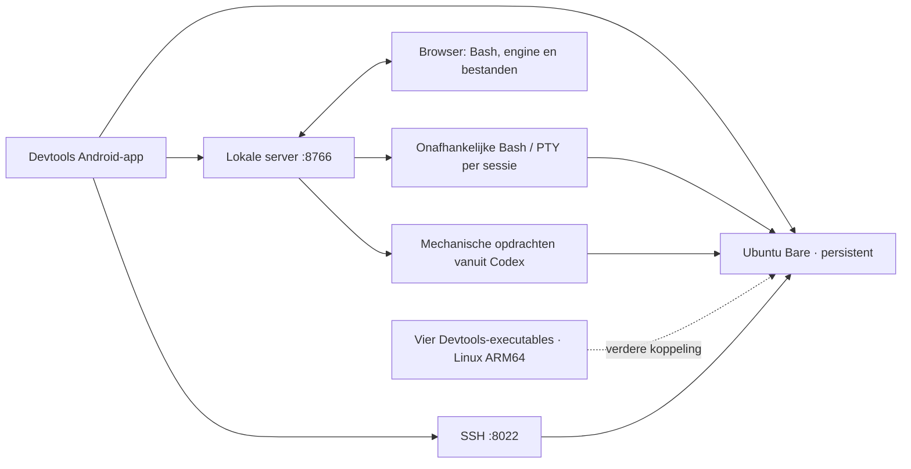

# Devtools Android

Dit is de lokale Android-host voor het Devtools-framework. De app bevat de volledige Ubuntu Bare-rootfs, PRoot, Bash/Unix98 PTY, browserassets, HTTP/WebSocket-server, SSH-runtime, bestandsbeheer en de mechanische machine-engine. Tijdens gebruik is geen externe host nodig. Ubuntu-pakketten en eigen bestanden blijven in de appopslag staan.

De huidige zichtbare naam is **Devtools**, versie `0.1.0-devtools`, versiecode `50`. De bestaande Android-app-ID `nom.vrd` en Java/JNI-namen blijven behouden, zodat de bestaande Ubuntu-opslag met dezelfde ondertekeningssleutel bruikbaar blijft. De bron is overgenomen uit `Dosa42/Ayrvokan_widgets` op commit `838779663991b999174a1245f2a0585f6fa1f19c`; interne NoMone-namen tonen de herkomst en blijven waar de bestaande runtime ze gebruikt.

De vier zelfstandige Rust CLI’s blijven naast deze app staan: `../devtool`, `../devtool-auto`, `../devtool-proof` en `../devtools-watch`. Hun Android/Termux-binaries gebruiken Android/Bionic; binnen Ubuntu zijn de Linux ARM64-builds nodig. Het bestaande Rust/WASM-ontwerp staat in `../devtool/ui`. Deze migratie verandert de indeling en functies van de huidige browserinterface niet; een nieuwe interface en verdere integratie volgen op basis van de volgende mock en uitleg.



## Bouwen

De rootworkflow [Build Devtools Android](../.github/workflows/build-android.yml) bouwt de native Android-PTY en Java/Smali opnieuw, voert de runtime-, terminal-, bestand- en enginecontroles uit en verpakt `devtools-arm64-v8a.apk` met SHA-256 als Actions-artifact. De oorspronkelijke buildworkflow wordt niet actief overgenomen. Linux/macOS-CLI- en WASM-workflows blijven afzonderlijk bestaan.

De eerste run importeert de vastgelegde oorspronkelijke snapshot één keer naar deze map en commit die in Devtools. `import.json` legt commit, inhoudshash en aantal bestanden vast. Daarna gebruikt iedere build de bron uit deze repository; de import maakt geen terugkerende afhankelijkheid van de oude repo. Buildcaches uit de oorspronkelijke snapshot zijn niet overgenomen.

Lokaal, vanuit deze map:

```sh
python tools/build-server-java.py
apktool build . --force --output ../.build/android/devtools-unsigned.apk
```

Gebruik Android SDK 35, Java, D8, dex2jar/baksmali en Apktool 3.0.3. De workflow ondersteunt `ANDROID_KEYSTORE_BASE64`, `ANDROID_KEYSTORE_PASSWORD`, `ANDROID_KEY_PASSWORD` en `ANDROID_KEY_ALIAS`. Zonder geconfigureerde sleutel maakt de run een testsleutel. Een update van een bestaande installatie vereist dezelfde ondertekeningssleutel als die installatie. De lokaal behouden ontwikkelsleutel en SSH-clientsleutel zijn geen onderdeel van de bronkopie.

Open de browserterminal op `http://127.0.0.1:8766/terminal`. [RUNTIME.md](server-java/RUNTIME.md) beschrijft PTY, processen en transport; [ENGINE.md](server-java/ENGINE.md) beschrijft het machineprotocol. De AI-adapter, afgedwongen harness en CLIProxyAPI-configuratie blijven de afgesproken vervolgstappen.
